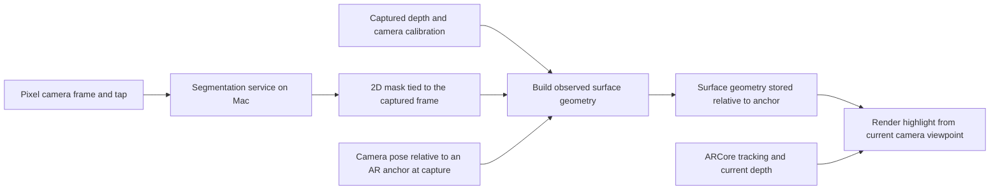

# Housing search, spatial room inspection, and personal object placement

Initial implementation plan · October 24, 2026

## Product and agreed direction

Build an app that filters housing by monthly rent and distance, helps someone inspect a room through the live camera on a Google Pixel 9a, and lets them preview objects they own in that space. The main spatial demonstration is selecting a room surface, segmenting it, and keeping its highlight attached to that surface while the phone moves.

The user confirmed live camera use inside the room. This is augmented reality (AR). Also support a digital room view on both platforms, where personal objects can be placed into an imported or simplified room model. Generating that room model from a video is an optional extension. A remote recorded tour and headset VR have separate capture and viewing requirements.

Core scope: housing filters, stable spatial segmentation, a personal-object library, capture of at least one owned object as a real 3D asset from multiple views, and object placement. Optional scope: automatic reconstruction of an entire room from captured or uploaded video.

Implementation is agent-led, with the user providing product decisions and access to the physical phone for testing. There is no confirmed deadline; organize work around demonstrable milestones. No implementation has started.

## First complete demonstration

1. Open the app on the Mac and filter clearly labeled sample listings by rent and distance from a chosen reference point.
2. Open the same housing interface on the Pixel, choose a listing, and enter its room-inspection view.
3. Move the phone slightly around a well-lit room to establish tracking and depth.
4. Tap a wall section or tabletop. The segmentation model proposes an outline; the user can correct the selection.
5. Show a translucent highlight on the selected physical surface.
6. Pan away, move a small distance sideways, and return. The highlight remains aligned with the surface during the same AR session.
7. Choose a previously captured personal object, place it on the floor or tabletop, and adjust its position and rotation at a calibrated real-world size.
8. Attach a note, such as “desk could go here,” and save screenshots, observed geometry, and placements for review on the Mac.
9. Open a digital room on either platform and place the same personal object there. Use an imported example room or a simple room layout if automatic room reconstruction is unavailable.

The first model interaction is tap-to-select. Object names can be entered by the user. Automatic recognition of every room object is a later feature; a segmentation mask alone does not supply an object name.

## Platform responsibilities

| Capability | Mac | Pixel 9a |
| --- | --- | --- |
| Housing filters, listing details, favorites | Browser app; installable web app | Shared interface packaged as an Android app |
| Live room inspection with spatial tracking | Review captured results | Native ARCore camera view |
| Segmentation computation for the first demo | Local model service | Sends selected camera frames and receives masks |
| Personal-object library and digital room layout | View assets and edit placements | Capture assets, view them, and edit placements |
| Object reconstruction | Local processing if supported; benchmark first | Guided photos/video capture |
| Saved results | Screenshots, notes, observed geometry, and object placements | Capture and review |

Cross-platform means shared product data and housing workflows, with hardware-specific AR on the phone. The Mac review view does not reproduce live phone tracking. Exported geometry is limited to captured surfaces; it is not automatically a complete room model.

Google lists the Pixel 9a as supporting ARCore and its Depth API. Confirm depth availability and performance on the actual phone during the first milestone. [Supported devices](https://developers.google.com/ar/devices)

## Recommended implementation

This stack is an engineering recommendation for the confirmed scope, rather than a requirement imposed by the sources.

| Component | Choice | Purpose |
| --- | --- | --- |
| Shared housing interface | React + TypeScript | Use the same screens and filtering logic on Mac and Android |
| Android packaging | Capacitor | Host the shared interface and open a native AR screen |
| Live AR | Kotlin + ARCore, starting from Google's sample renderer | Access camera frames, poses, depth, anchors, and native rendering |
| Segmentation service | Python + FastAPI + PyTorch | Accept a frame and selection prompt; return its mask |
| Initial model | SAM 2.1 Tiny or Small, selected by a benchmark | Establish a promptable segmentation baseline |
| Demo records | SQLite and local files | Store listings, notes, screenshots, and geometry |
| Digital room viewer | Three.js | Inspect rooms, annotations, and personal-object placements on both platforms |
| Object reconstruction candidate | RealityKit Object Capture on a supported Mac | Build a textured model from guided photographs or selected video frames |
| Asset interchange | GLB/glTF, with a validated conversion step | Reuse object assets in the web viewer and native AR renderer |
| Optional room reconstruction | Open3D RGB-D fusion | Combine recorded depth and camera poses into observed room geometry |

Capacitor supports native Android plugins written in Java or Kotlin. We would implement our AR screen and bridge; Capacitor does not supply this room-segmentation feature. [Android plugin documentation](https://capacitorjs.com/docs/plugins/android)

ARCore's official Kotlin/Java samples already provide camera rendering, plane detection, and placing content on surfaces. Extend that baseline before building custom spatial behavior. [ARCore Android quickstart](https://developers.google.com/ar/develop/java/quickstart)

SAM 2 supports image and video segmentation. Begin with individual selected frames so model latency does not govern camera responsiveness. Its official demo includes CPU, CUDA, and preliminary Apple GPU paths; performance on this Mac remains to be measured. [SAM 2 repository](https://github.com/facebookresearch/sam2), [official inference implementation](https://github.com/facebookresearch/sam2/blob/main/demo/backend/server/inference/predictor.py)

SAM 3/3.1 is an optional candidate if text-based selection becomes necessary. Its documented installation requires a CUDA-compatible GPU and checkpoint access, so it should not be a dependency for a Mac-and-Pixel-only demonstration. [SAM 3 repository](https://github.com/facebookresearch/sam3)

Prototype arbitrary model loading and depth compositing in the native renderer before promising asset-format compatibility. The initial AR sample is a tracking baseline, not a complete personal-object renderer.

## How the highlight stays in the room

Segmentation answers “which pixels belong to the selected surface?” Spatial tracking answers “where is the camera?” Depth or a detected plane connects those image pixels to physical geometry. All three are needed for the proposed interaction.

Implementation sequence:

1. Capture a frame ID, image, timestamp, camera calibration, image-coordinate transforms, depth, and the camera pose relative to a nearby anchor. Keep spatial information associated with that original frame while inference runs.
2. Send the image, frame ID, and tapped location to the model service. Return a mask with its coordinate mapping back to the original image.
3. Use valid depth samples inside the mask to recover surface points. Transform them into the anchor's local coordinates. For the first flat surface, robustly fit a plane and project the selected region onto it.
4. Build a bounded surface polygon with the selected outline. Reject inconsistent samples and regions without enough geometric support.
5. Attach this geometry to the anchor. Render it from the phone's current tracked viewpoint on every display frame, independently of model inference.
6. Use current scene depth for occlusion where reliable. Show tracking or depth problems and request another scan when necessary.

An anchor stabilizes a coordinate frame; it does not convert a 2D mask into a 3D object. The geometry-building step is our implementation. ARCore provides the underlying tracking and depth capabilities. [Anchors](https://developers.google.com/ar/develop/anchors), [Depth API](https://developers.google.com/ar/develop/depth)

Camera images and depth images may differ in crop, resolution, and orientation. Map them using ARCore's documented coordinate transforms. An asynchronous model result must use its captured frame's spatial data, not the latest camera pose. Discard results from ended sessions or superseded selections. [Depth coordinate conversion](https://developers.google.com/ar/develop/java/depth/developer-guide)

For irregular furniture, extend the geometry step to fuse observed depth samples from several viewpoints into labeled surface geometry. That is a later milestone with greater uncertainty. One image cannot reveal an object's hidden surfaces. Moving furniture also requires separate object tracking or re-selection; the initial annotations assume static surfaces.

## Personal-object capture and placement

The object is captured once, then reused in live AR or a digital room. Start with one static, textured, nonreflective object that can be photographed from several sides.

| Input | Representation | Role in the plan |
| --- | --- | --- |
| One photograph | Segmented cutout on a flat surface, with user-entered dimensions | Early preview and fallback; explicitly labeled as a photo preview |
| Guided overlapping photos or an orbit video | Reconstructed textured 3D mesh | Recommended route for the first true 3D personal asset |
| One photograph plus an image-to-3D model | Generated 3D approximation with inferred hidden surfaces | Optional experiment if suitable compute is available |

Recommended capture-to-placement workflow:

1. Select “Add my object” and capture overlapping views by moving around the stationary object. Offer a guided photo sequence and video recording; extract sharp, sufficiently different frames from video.
2. Use segmentation to isolate the object and allow the user to correct masks. Preserve capture metadata and useful visual features for reconstruction.
3. Reconstruct on the Mac. Check RealityKit Object Capture hardware support in milestone 0; it accepts photographs from other cameras, so capture does not require an iPhone. Validate the complete Pixel-image-to-model path before choosing it permanently. [Object Capture](https://developer.apple.com/documentation/realitykit/realitykit-object-capture), [capture requirements](https://developer.apple.com/documentation/realitykit/capturing-photographs-for-realitykit-object-capture)
4. Clean and simplify the result, orient it upright, set its bottom pivot, and convert it into the application's supported 3D format. Validate textures and appearance in both viewers.
5. Ask for or confirm width, height, and depth. Calibrate scale using a known measurement and check the other dimensions. Use meters internally; retain how scale was obtained. Visual reconstruction is not a guarantee of measurement accuracy.
6. Save the item in “My objects,” with its thumbnail, dimensions, representation type, and reconstruction status.
7. Place it on a detected surface in live AR, or on a floor in the digital room. Support drag, rotate, delete, and undo. Preserve the calibrated size by default; mark any user size override.
8. Save placements as object references plus transforms relative to the room or session coordinate frame. A digital-room placement is persistent data; bringing it back into the physical room in a later session still requires alignment or relocalization.

A single photo can also produce a generated 3D asset: SAM 3D Objects is one candidate. Its documented setup requires Linux and an NVIDIA GPU with at least 32 GB VRAM. It is therefore an optional remote-compute path, and its unseen surfaces should be treated as inferred rather than measured. [Model](https://github.com/facebookresearch/sam-3d-objects), [setup requirements](https://github.com/facebookresearch/sam-3d-objects/blob/main/doc/setup.md)

Apple's capture guidance calls for overlapping, well-lit views and warns about reflective, transparent, thin, and textureless objects. We should communicate capture quality in the workflow and support retakes. [Capture guidance](https://developer.apple.com/documentation/realitykit/capturing-photographs-for-realitykit-object-capture)

Object reconstruction is a background job, with progress, cancellation, and a clear failure state. A flat photo preview is useful while this pipeline is being built, but does not complete the true-3D capture milestone.

## Optional room reconstruction from video

Prefer a guided scan recorded in our Pixel app. Save color keyframes, depth samples and their available confidence data, camera intrinsics, coordinate mappings, timestamps, and tracked poses. Preserve the actual timestamp of each depth observation and avoid counting reprojected or repeated depth as a new independent measurement. Keep capture metadata as sidecar data rather than assuming a normal video file contains it.

Proposed processing path:

1. Guide the user to walk through the room with overlapping views and some sideways movement.
2. Filter unreliable depth, check pose consistency, and combine the observations in one coordinate frame.
3. Fuse depth into a surface volume on the Mac, extract a coarse mesh, and add captured color where possible.
4. Detect or let the user correct the floor and major walls. Preserve holes and unknown regions instead of presenting them as measured surfaces.
5. Reduce model complexity and open the room in the shared viewer, with support for placing personal objects.

Open3D provides RGB-D fusion and mesh extraction given calibrated images and camera poses. Applying it successfully to this phone's depth, including tracking drift and inconsistent observations, is an implementation experiment. [RGB-D integration](https://open3d.org/html/tutorial/pipelines/rgbd_integration.html)

Also consider ordinary uploaded room video, but classify it separately: select frames, estimate camera motion, reconstruct geometry, then establish scale from a known dimension. COLMAP documents this multi-view reconstruction pipeline. An arbitrary video may lack the coverage or motion needed for a usable room. [COLMAP reconstruction tutorial](https://colmap.github.io/tutorial)

This feature can run after recording; real-time full-room reconstruction is not a requirement. No promise of a complete, watertight, accurately measured room is needed for the prototype. Do not assume Apple's RoomPlan supplies the Pixel implementation: it relies on supported iPhone/iPad cameras and LiDAR. [RoomPlan](https://developer.apple.com/augmented-reality/roomplan/)

Fallbacks, available without automatic reconstruction:

- Import an existing room model for the demonstration.
- Create a simple editable room from entered dimensions and major wall positions.
- Use live AR placement directly in the physical room; that only needs local surfaces and tracking.

Label room assets as imported, simplified, or scanned, and retain their scale and capture-quality information. When processing fails, offer a retake or one of these fallbacks without blocking housing search or personal-object placement.

## Housing scope

- Start with 10–20 explicitly fictional or manually supplied listings.
- Required fields: listing ID, title, monthly rent and currency, latitude, longitude, room description, and images.
- Let the user select a reference location and maximum radius. Initially, “distance” means straight-line distance, clearly labeled in the interface.
- Apply rent and radius as hard filters; offer rent and distance sorting.
- Support favorites and opening a listing's room-inspection session.
- Link a room session to the listing the user chose. Do not assume the camera can identify which property someone is visiting.

Commute times, paid mapping services, listing-provider integration, accounts, and messaging are later product decisions. The first demonstration should run without a live property-data provider.

## Milestones and acceptance gates

| Order | Deliverable | Evidence needed before proceeding |
| --- | --- | --- |
| 0 | Development and device readiness | Android sample installs on the Pixel; camera, depth, and tracking work; one model frame completes on the Mac; object-reconstruction hardware support is checked |
| 1 | Spatial tracking baseline | Manually placed surface marker remains aligned through a repeatable pan-and-return test |
| 2 | Model interaction | Tap-to-segment works on real room frames; corrections and explicit failure states are available |
| 3 | Spatial segmentation | A model-selected flat surface becomes anchored geometry and survives rotation and sideways movement |
| 4 | Object placement and digital rooms | One imported model loads at the same calibrated size in Pixel AR and the shared digital room viewer; move, rotate, save, and reload work |
| 5 | Personal-object capture | At least one owned object is reconstructed from guided photos/video into a textured 3D asset, then placed successfully in both views; a photo-only fallback is visibly distinguished |
| 6 | Cross-platform housing app | Filters and favorites work on both devices; a selected listing opens the Pixel AR view and its associated room data |
| 7 | Complete core presentation | Housing search, stable segmentation, personal-object capture, and placement form one working flow; three repeated demo runs succeed |
| Optional | Video-to-3D room | One guided Pixel recording produces a navigable rough room model; dimensions are checked against reference measurements; failure leaves the fallback room available |

Build the spatial proof first because it is the largest technical uncertainty. Housing screens can then integrate with an already proven interaction.

Targets to test, not performance claims:

- Aim for at least 30 rendered frames per second while one surface is highlighted.
- Aim for selection feedback within 3 seconds at a benchmarked image size; display processing progress if slower.
- Aim for less than 5 cm of apparent surface displacement at roughly 2 m viewing distance after a 30-second movement sequence, in favorable tracking conditions.
- Use a fixed room, known-size reference marks, saved camera frames, and a repeatable movement sequence to estimate alignment error and record failures.
- Repeat the complete flow three times, including a pan away and return. Record model latency, render rate, drift, and any tracking resets separately.
- Verify one captured object's calibrated dimension in both viewers and compare its remaining dimensions with physical measurements. Reopening a saved digital room must preserve the object's position, rotation, and scale.
- For an optional reconstructed room, inspect missing geometry and compare at least two known distances before describing its dimensions as usable.

If these targets fail, investigate camera/depth alignment, tracking quality, inference latency, and geometry errors separately before expanding scope.

## Important boundaries and failure handling

- **Depth initialization:** ask for a small sideways movement during scanning. Pure rotation provides little triangulation baseline. Blank walls, reflections, and poor lighting may give weak depth or tracking. Use a textured, well-lit surface for the initial demonstration. [Depth behavior](https://developers.google.com/ar/develop/depth)
- **Inference speed:** benchmark Tiny and Small on the actual Mac. Keep inference off the render loop. Consider remote compute only if measurements justify it and the user chooses it.
- **Network:** the first two-device demo uses the Mac as a reachable local service, through a configured local connection or USB forwarding. Phone-to-Mac connectivity is part of milestone 0.
- **Persistence:** annotations remain spatially anchored within one active AR session. Saving screenshots or geometry for review does not make local anchors survive app restarts. Cross-session relocalization is separate work. [Anchor lifetimes](https://developers.google.com/ar/develop/anchors)
- **Tracking loss:** pause spatial updates, show a recovery state, and re-establish tracking before resuming. Do not substitute a screen-fixed highlight for a spatially attached one.
- **Capture:** segmentation uses selected frames. Object scanning and optional room scanning are explicit capture modes that save their inputs for reconstruction; ordinary inspection does not require continuous recording.
- **Scale and representation:** keep photo previews, generated 3D approximations, captured object meshes, and simplified rooms distinct. Record real measurements separately from visual reconstruction output.

## Later extensions, in priority order

1. Optional guided video-to-3D room reconstruction.
2. Several static segmented objects in one room and improved foreground occlusion.
3. Single-photo generated 3D objects if suitable compute becomes available.
4. More complete surface capture and room-to-room navigation.
5. Optional wall recoloring using the captured surfaces.
6. Cross-session room recognition and annotation recovery.
7. Recorded remote tours, with capture quality and viewing requirements defined separately.
8. Real property feeds and route-based commute filtering.

The next implementation step is milestone 0 followed by a phone demonstration of a manually anchored surface. A successful result establishes the tracking foundation for segmentation.

## Revision — 24 October 2026: scan your stuff, place it in the new room

Decided after milestones 0–3 and the first Create-mesh integration run.

**Dropped:** live 3D removal/inpainting of real objects in the camera view. It depends on a perfect background reconstruction from phone captures and proved fragile.

**New core flow**

1. **Scan.** In the app, record a walk-through of your belongings: keyframes with depth, confidence and ARCore poses relative to a level scan anchor (`housingar.scan.v1`). It uploads to the Mac.
2. **Proposals.** The Mac fuses the scan into one metric scene, removes floor and walls, and finds separate objects. Those include furniture and the items resting on it, linked parent/child. It segments each with SAM 2.1 and builds a real-size textured mesh. The phone shows the proposals; you keep, name or discard each one.
3. **My stuff.** Kept objects persist on the Mac as a library: name, real dimensions, mesh and thumbnail.
4. **Missed objects.** Capture them one at a time with tap-to-select and the guided walk-around (`housingar.capture.v1`), then add them to the library.
5. **New room.** In the apartment, the live camera view places library objects on the real floor or tables at real size. Move, rotate or delete them, and save the layout for review on the Mac.

Unchanged: housing search, opening a listing's room session, and the Mac as local compute.

**Milestones (replacing 4–5)**

| Order | Deliverable | Evidence |
| --- | --- | --- |
| S1 | In-app scan and upload | A scan of at least 100 keyframes passes the Mac validator |
| S2 | Object proposals | Synthetic multi-object scan: every object proposed, dimensions within 2 cm, placement within 3 cm |
| S3 | Proposal review and library | Keep and name proposals on the phone; the library survives app and service restarts |
| S4 | Live-camera placement | Several library objects placed at calibrated size, moved and rotated; layout saved |
| S5 | Individual capture into the library | A missed object captured alone appears in My stuff and can be placed |
| S6 | Real end-to-end runs | Three runs: scan your room, keep at least 3 objects, place them in another room, and check one dimension against a tape measure |

## Revision — 24 October 2026: tap each thing during the scan

Real phone scans produced only a few small fragments with automatic discovery. New scans therefore use `housingar.scan.v2`: the user taps each thing to keep and walks around it. The Mac follows those explicit selections with SAM 2 video and builds exactly one ordered proposal per tap, including a visible failure reason when reconstruction cannot succeed. It does not discover extra objects or infer parent links for v2. The existing v1 upload remains compatible.

S1–S6 still apply, with S2 now checking the selected desk, box, cylinder and chair rather than automatic discovery. The synthetic size target remains 2 cm and the bottom-centre placement target 3 cm. Real-room quality still needs physical phone scans and measured dimensions. The contract is [scan_v2.md](docs/scan_v2.md); measured implementation evidence is in [scan_v2_results.md](docs/scan_v2_results.md). Local Wi-Fi is an explicit service option; localhost remains the default.

## Revision — 24 October 2026: reconstruct phone objects from masked photos

The three supplied 1920×1080 Pixel recordings show that 160×90 motion-stereo raw depth cannot support an 8 mm object TSDF. Real high-resolution tapped scans and individual captures now select masked Apple Object Capture photogrammetry by default. The Mac aligns recovered photo cameras with metric ARCore VIO, keeps image geometry independent of depth clipping, checks upper/lower RGB outline coverage, and bakes texture using mesh visibility. Repair must preserve the photo extent and yield one watertight surface within the existing 50k-triangle phone contract. Depth is an explicit, coarse, confidence-filtered fallback, always identified and flagged for review. Small synthetic captures retain the measured depth path.

Apple's public sample API does not accept externally fixed camera poses/intrinsics: this backend estimates photo cameras and uses VIO for metric registration, rather than claiming pose-locked MVS. The supplied masks and gravity are actual photogrammetry inputs. A future pose-locked COLMAP/OpenMVS backend remains separate work; the implemented backend is Apple Object Capture. See [the reconstruction contract and measured results](docs/image_reconstruction_results.md).

## Revision — 25 October 2026: real rental search and estimated digital rooms

The Mac service owns RentCast-backed rental search, Census address geocoding, quota-preserving 24-hour disk caching, clearly marked offline samples, and per-listing room/furniture persistence. A listing opens as an explicitly estimated rectangular room plan derived from its area and room counts; the user may edit it. My stuff items use their existing metre-scale bottom-centre GLBs, with position and yaw saved in plan coordinates.

The separately built `web/` UI renders those rooms. The service serves `web/dist` read-only at `/` when available, while preserving `/v1` and same-origin asset URLs. Vite development uses the specified localhost CORS origins. Android and website source remain independently owned. The contract is [listings_v1.md](docs/listings_v1.md), with evidence in [listings_v1_results.md](docs/listings_v1_results.md). Real results require the server-side `RENTCAST_API_KEY`; without it the API must remain unmistakably fictional.
