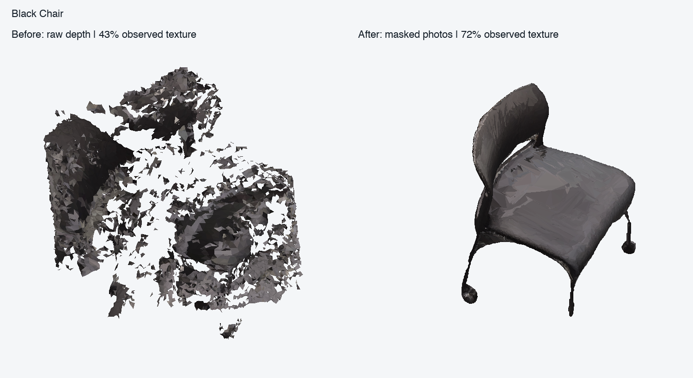
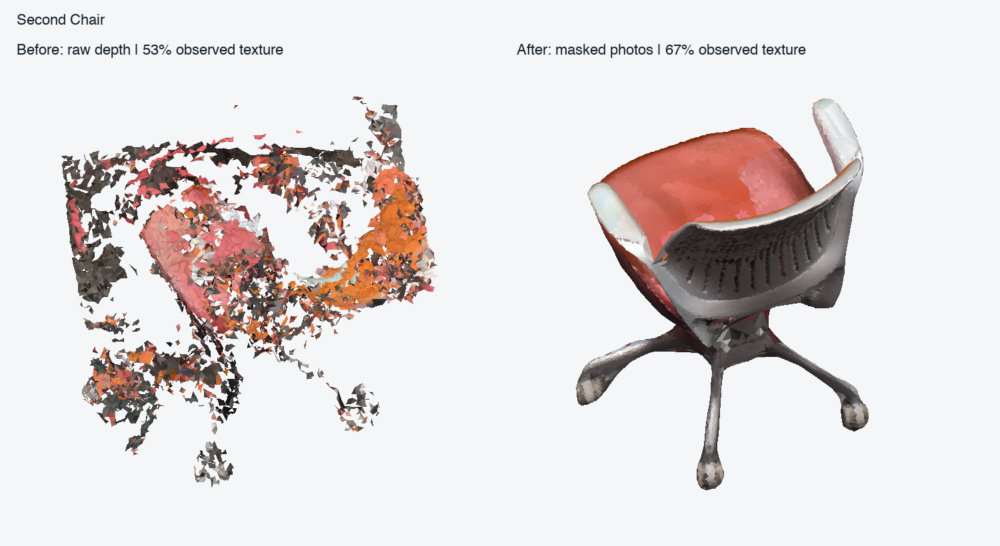
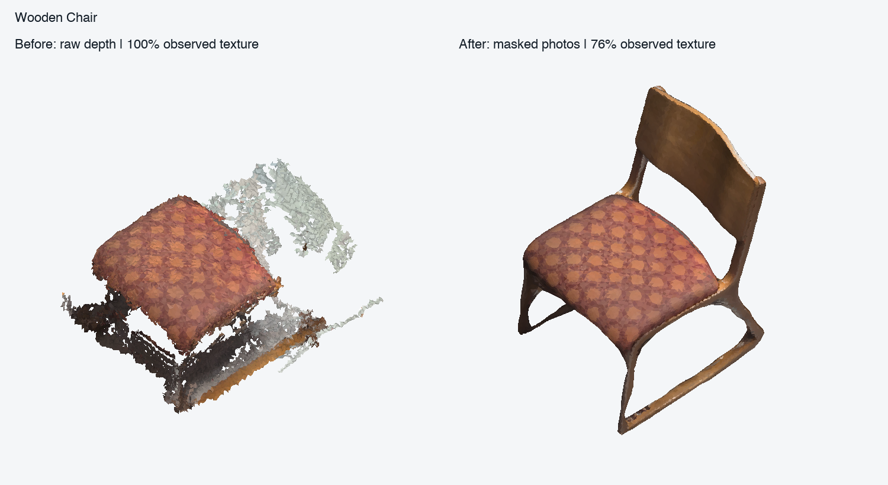

# Pixel object reconstruction: masked photos replace raw-depth surfaces

Measured on 24 October 2026, Apple M5 / 16 GiB, macOS 27.0.1, Python 3.12.13, Open3D 0.20.0. **All three supplied recordings now produce one watertight, non-self-intersecting chair mesh**, with seat, back and lower structure retained. Android source was not modified. The original jobs remain intact; new assets are under `segmentation-service/data/image-regression/`.

## Actual backend and metric calibration

The implemented main backend is **Apple RealityKit Object Capture**, using the original 1920×1080 RGB keyframes, supplied sensor-orientation SAM masks, gravity, high feature sensitivity and medium-detail reconstruction. The old helper set `isObjectMaskingEnabled=false`, which prevented correct masked processing; it is now enabled. [Apple mask configuration](https://developer.apple.com/documentation/realitykit/photogrammetrysession/configuration-swift.struct/isobjectmaskingenabled).

Apple's public `PhotogrammetrySample.camera` cannot be set: this implementation **does not claim externally fixed or initialised VIO cameras**. Apple estimates photo cameras internally; a robust similarity fit registers their camera centres to the phone's metric VIO trajectory. Recovered photo poses and, on macOS 26+, recovered intrinsics are used for texture projection. A pose-locked COLMAP/OpenMVS backend was not implemented or benchmarked. [Apple camera API clarification](https://developer.apple.com/forums/thread/840946), [recovered pose intrinsics](https://developer.apple.com/documentation/realitykit/photogrammetrysession/pose).

Raw depth neither generates nor clips the primary object surface, and a noisy TSDF no longer vetoes photo dimensions. Depth remains available for a weak selection prior, support diagnostics, legacy background reconstruction, and an explicitly identified fallback. Metric size comes from phone VIO calibration, **not supplied manual dimensions**. These are plausible reconstructed dimensions, not tape-measure accuracy claims.

## Before and after

Dimensions use long horizontal footprint axis × gravity height × other horizontal axis. Components are counted after welding UV seams. “Observed texture” is the fraction of used atlas texels sampled from source photos; the remainder is explicitly filled.

| Recording | Before dimensions (cm) | After dimensions (cm) | Before exported → after components | Observed texture before → after |
| --- | --- | --- | --- | --- |
| `6fb50237_scan_93413134`, black chair | 92.0 × 67.9 × 82.4 | **53.2 × 79.0 × 52.3** | **466 → 1** | **43.2% → 72.4%** |
| `baae385b_scan_91807239`, second chair | 83.1 × 78.5 × 78.0 | **67.9 × 88.4 × 65.7** | **812 → 1** | **53.0% → 66.9%** |
| `d7ce4323_obj2_70861434`, wooden chair | 84.1 × 36.5 × 62.8 | **57.4 × 81.8 × 50.0** | **67 → 1** | 99.9%* → **76.3%** |

The reported 3,619 and 4,767 component counts are retained TSDF fragments before export. The old decimated GLBs contain 466 and 812 components after welding UV seams: simplification already discarded many fragments. New exports contain one complete connected surface.

*The wooden-chair “before” is the original recording's incomplete 36.5 cm-high mesh. Its almost-100% texture score counted only the surviving fragments; it did not establish complete geometry. The previous depth-only repair reached 75 cm but still had 2,587 fragments. The new result restores connected photo-derived geometry rather than preserving that fragmentation.*







These CPU comparison renders use the exported GLBs, source textures and a common anchor-frame camera/scale. They are not generated concept images. Facets and approximate thin details remain visible; unobserved undersides are not counted as observed texture.

## Stages and quality checks

| Stage | Black chair | Second chair | Wooden chair |
| --- | ---: | ---: | ---: |
| Input RGB views | 55 | 60 | 50 |
| Recovered photo cameras / VIO inliers | 55 / 55 | 59 / 48 | 50 / 50 |
| Registration RMS | 0.59 cm | 1.36 cm | 1.13 cm |
| Registration scale | 1.27575 | 1.29777 | 1.13723 |
| Photo triangles before repair | 15,404 | 18,904 | 19,828 |
| Welded photo components | 4 | 1 | 1 |
| Final triangles | **38,490** | **18,662** | **19,826** |
| Final components / boundary edges / self-intersections | **1 / 0 / 0** | **1 / 0 / 0** | **1 / 0 / 0** |
| Median source-mask recall | 96.5% | 94.8% | 95.9% |
| Median source-mask precision | 96.0% | 97.0% | 99.0% |
| Lower-region mask recall | 79.6% | 82.2% | 87.4% |
| Upper-region mask recall | 98.5% | 93.1% | 95.4% |
| Geometry + repair wall time | 33.80 s | 29.42 s | 23.47 s |
| Texture + GLB validation/export wall time | 31.97 s | 30.59 s | 21.08 s |
| Total reconstruction wall time | **65.77 s** | **60.02 s** | **44.55 s** |

The primary runs reused the original **real official-SAM video masks**, not synthetic or geometric replacement masks. Their manifest/RGB/mask hashes are saved in each `result.json`. SAM inference is excluded from those timings. Native Apple execution may use macOS acceleration; these timings are **not CPU-only photogrammetry or PyTorch MPS benchmarks**. Other regression checks ran during part of the measurements. Outline and exported-topology checks were also repeated independently after reconstruction.

For the wooden capture, actual photo vertices above the seat-level anchor plane +5 cm are **4,142 before repair** (including native UV duplicates) and **3,401 after repair**. Gravity heights remain **−44.89 to +36.92 cm**, so repair retains both the back and lower structure. These vertex counts differ from raw-depth observation counts. Full height evidence is recorded in each result and the portable measured-results JSON.

Welding removes duplicated vertices at photo UV seams before evaluating connected components. Boundary/intersection repair must preserve the original extent within max(1.5 cm, 3% per axis). The black chair's first generic repair was rejected because it removed substantial leg height. Bounded photo-surface closure at 3 mm retained the structure; two short leg/caster connections were admitted only with **100% and 90.4% minimum multi-view mask agreement**, while a disconnected piece with only 78.2% agreement was rejected. These connections are constrained completion, not directly measured surface detail.

New image and coarse-depth exports are reloaded after writing. Welding their UV seams must yield **one watertight component, no self-intersection, and ≤50,000 triangles**. Source-mask quality also checks upper and lower object regions, so a closed seat-only mesh cannot pass on topology alone. All three recorded image outputs pass these gates and report object `low_quality=false`; this does not promise perfect hidden geometry.

Texture visibility now ray-tests the reconstructed surface using recovered photo cameras. The old ±2.5 cm sparse-depth gate is retained only for legacy depth/background textures. This prevents valid photo surfaces from losing texture solely because 160×90 depth disagrees.

## Explicit depth fallback

Real-phone fallback estimates voxel size from metric depth-pixel footprint and measured support-plane spread, with a 2 cm noise floor. Confidence must be ≥192/255. It retains the surface component connected to the metric tap (or reliable masked seed depth), closes holes, smooths, and validates the exported topology. If closure cannot preserve the selected surface safely, the object fails visibly instead of returning fragments.

On the black recording, the fallback used a **2.0 cm requested voxel** (1.968 cm actual bounded TSDF grid), **1.14 cm median depth-pixel footprint**, **108,773 support-rejected confident observations**, then **48 → 1 components**. Its final closed surface has **43,996 triangles**. Its gravity-aligned raw bounds span only about **60.4 cm in height**: it remains explicitly **low quality**, and is not substituted for the much better photo result. Detailed stages are in `data/image-regression/black-chair/depth-fallback.json`.

## Full jobs and compatibility

- **Complete real scan, automatic backend:** `data/scan-image-e2e/`. Verified saved official SAM tracks; photo geometry selected automatically without an object TSDF. **37,590 triangles, one watertight component, 51.6 × 79.5 × 51.4 cm, 72.6% observed texture, object low_quality=false**. Tracking/refinement 3.72 s, geometry 33.50 s, texture/export 33.00 s. Small repeat differences are native photogrammetry variability, not known physical measurement error.
- **Complete wooden-chair capture, fresh official SAM CPU:** `data/image-capture-e2e/`. Masking 90.53 s, image geometry 37.25 s, object texturing 45.62 s, total including legacy background work **201.11 s**. **57.7 × 81.1 × 50.3 cm, 75.6% observed texture**, complete object quality passes. Its legacy removal background remains low quality. New real-object reports separate `object_low_quality` and `background_low_quality`, with `quality_scope: "object"`; background diagnostics remain available. The recorded report's scope was reassessed after this reporting change without rerunning geometry.
- **Phone-packaged capture fixture, fresh official SAM CPU:** `data/image-phone-fixture/`, **90.51 s**. Every README target passes: bounds, four top corners, placement, support, no patch inside the object, and quality. Worst top-corner distance **0.244 cm**, placement error **1.401 cm**, support **100/100 rays**. Small synthetic input retains its legacy depth backend and combined object/background quality scope.
- **120-view four-object synthetic scan:** `data/image-synthetic-scan/`. Verified replay of saved official-SAM tracks; inference not retimed. **4/4 pass**, worst dimension error **1.241 cm**, worst bottom-centre error **1.482 cm**.
- **CPU service regressions:** **187 passed in 192.81 s**; log: `data/image-reconstruction-tests-final.txt`. Upstream Starlette/scikit-image emit 50 deprecation warnings; no test failed. Tests need no learned-weight download. They include three portable real photo-surface fixtures, rejection of destructive repair, missing-upper-half quality failure, confidence/resolution/tap-component fallback, photo routing when depth refinement fails, visible failure when neither backend works, and exported UV-seam/topology checks.

## Reproduce and inspect

```bash
cd segmentation-service
.venv/bin/pip install -r requirements-reconstruction.txt
bash reconstruction/build.sh
.venv/bin/python scripts/regress_real_reconstruction.py --output data/new-image-regression
.venv/bin/python scripts/render_reconstruction.py data/new-image-regression \
  --output ../docs/assets/new-image-regression
.venv/bin/pytest -q
```

The regression runner preserves original jobs and writes `object.glb`, `result.json`, intermediate registered/selected surfaces, recovered cameras, Swift logs and stage diagnostics per recording. Portable CPU evidence and hashes are under [fixtures/real_reconstruction](../fixtures/real_reconstruction/README.md). `auto`, `photo` and `depth` settings and offline CLI flags are documented in the [service README](../segmentation-service/README.md#image-based-geometry-for-real-phone-recordings).
